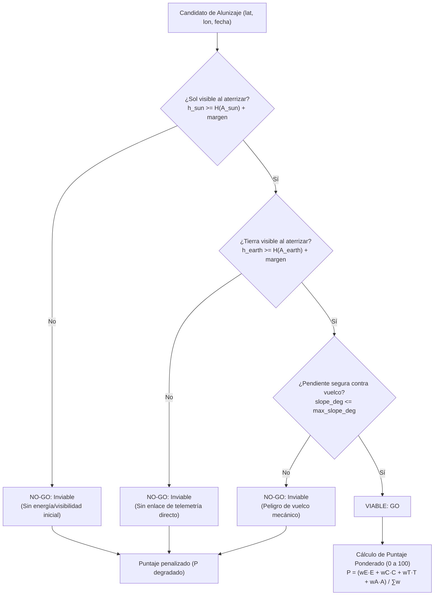

# Modelo de Mapeo Solar, Viabilidad Temporal y Factores de Decisión

Este documento detalla los fundamentos astrofísicos, matemáticos y computacionales detrás del **Mapeo Solar**, la **dinámica temporal de viabilidad de misión** y la **separación entre factores excluyentes (Hard Constraints) y factores ponderados (Soft Constraints)**.

Sirve como referencia técnica formal para el equipo ante el jurado de la NASA y como especificación de diseño previa al refactor arquitectónico.

---

## 1. El Fenómeno Astrofísico: ¿Por qué la Luna es casi uniforme (~50% naranja) excepto en los polos?

### 1.1 El Ciclo Sinódico Lunar en Latitudes Ecuatoriales y Medias ($|\text{lat}| < 70^\circ$)
La Luna se encuentra en acoplamiento de marea (*tidal locking*) con la Tierra, completando una rotación sobre su eje en el mismo tiempo que tarda en orbitar nuestro planeta (~27.3 días sidéreos). Sin embargo, con respecto al Sol, el ciclo día/noche (el **mes sinódico lunar**) dura aproximadamente **29.53 días terrestres**:

$$\tau_{\text{sinódico}} \approx 708.7 \text{ horas} \approx 29.53 \text{ días}$$

En cualquier punto situado entre el ecuador y los $70^\circ$ de latitud (sea la cara visible o la cara oculta):
- El Sol sale por el Este, recorre el cielo a lo largo de **~14.76 días terrestres continuos de luz abrasadora** (hasta $+120^\circ\text{C}$).
- El Sol se pone por el Oeste, seguido de **~14.76 días terrestres continuos de noche gélida** (hasta $-130^\circ\text{C}$).

$$\text{Exposición Solar Media Global} = \frac{14.76\text{ días}}{29.53\text{ días}} \approx 50.0\%$$

Por este motivo, en un mapa solar que mide el porcentaje de tiempo iluminado a lo largo del ciclo sinódico, **el 90% de la superficie lunar es exactamente un 50% de iluminación**. En nuestra paleta de colores térmica (que va de 0% azul marino a 100% amarillo oro), **el 50% cae en el color naranja ocre**. Esto no es un error de renderizado: **es la realidad astrofísica de la Luna**.

### 1.2 La Singularidad de los Polos Lunares ($|\text{lat}| > 80^\circ$)
La física solar cambia drásticamente en los casquetes polares debido a una constante astronómica fundamental:

$$\varepsilon_{\text{luna}} = 1.54^\circ \quad (\text{oblicuidad del eje de rotación lunar respecto a la eclíptica})$$

A diferencia de la Tierra (cuya inclinación de $23.44^\circ$ genera veranos cálidos e inviernos polares con noches de meses), el eje lunar es casi estrictamente perpendicular al plano orbital de la Tierra alrededor del Sol. 

Como consecuencia:
- En los polos, el Sol **nunca se eleva alto en el firmamento**.
- El centro del disco solar oscila a ras de tierra en una franja extremadamente estrecha:
  $$h_\odot \in [-1.54^\circ, +1.54^\circ]$$
- El Sol se mueve horizontalmente en $360^\circ$ alrededor del observador rozando el horizonte a lo largo del mes.

### 1.3 Picos de Luz Eterna (PELs) y Regiones de Sombra Permanente (PSRs)
En esta geometría rasante, el relieve topográfico (medido con precisión de metros por el altímetro láser LOLA a bordo del LRO de la NASA) domina por completo la iluminación:

1. **Picos de Luz Eterna (PELs - *Peaks of Eternal Light*):**
   Crestas elevadas, macizos y bordes de cráteres de impacto (por ejemplo, el borde del cráter Shackleton, Mons Mouton o Malapert Mountain) se elevan por encima del horizonte aparente. Debido a su altitud, interceptan continuamente el disco solar rasante, alcanzando exposiciones del **$70\%$ al $90\%+$** a lo largo de meses o años (**Amarillo oro brillante en el mapa**).
2. **Regiones de Sombra Permanente (PSRs - *Permanently Shadowed Regions*):**
   Los fondos profundos de los cráteres polares (a 2,000–4,000 m bajo el nivel medio) quedan bloqueados perpetuamente por las paredes de sus propios bordes. No han recibido un solo fotón solar directo en más de 2,000 millones de años. En su interior la temperatura desciende a **40 Kelvin ($-233^\circ\text{C}$)** y albergan depósitos estables de hielo de agua (**Azul marino oscuro $0\%$ en el mapa**).

---

## 2. Cómo se Calcula el Mapa Solar en Zenith

El cálculo se articula en dos niveles de detalle con algoritmos adaptados a su escala:

### 2.1 Nivel Macro: Grilla Global de la Luna ($72 \times 36$ celdas)
Implementado en `backend/app/controllers/scores.py` (`_build_risk_grid`):
- Evalúa la latitud $\phi$, longitud $\lambda$, elevación local $z$ (m) y orientación de pendiente (*aspect* $\gamma$).
- Para latitudes no polares ($|\phi| \le 65^\circ$):
  $$\text{solar\_exp} \approx 50\% + 3\% \cos(\phi)$$
- Para latitudes polares ($|\phi| > 65^\circ$):
  Se modula analíticamente por la elevación hipsométrica y la exposición azimutal:
  $$\text{polar\_solar} = 45\% + 18\% \cdot \text{clip}\left(\frac{z}{2000\text{ m}}, -1, 1\right) + 15\% \sin(\beta) \cos(\gamma_{\text{ecuador}})$$
  - Si el punto es una cumbre polar ($z > 0$), su exposición sube hacia $75\% - 90\%$.
  - Si el punto es una fosa o cuenca ($z < -1000\text{ m}$), cae a trampas frías de $5\% - 20\%$.

### 2.2 Nivel Micro: Parche 2.5D Local de Relieve LOLA ($25 \times 25$ a $128 \times 128$ celdas)
Implementado en `backend/app/models/terrain.py` (`compute_patch_solar_grid`):
Para el sitio seleccionado, calcula el trazado de rayos exacto con la topografía real:

1. **Trayectoria Solar Efeméride ($t_0 \dots t_0 + \Delta t$):**
   Calcula la serie de azimut $A_\odot(t)$ y elevación $h_\odot(t)$ con pasos $\Delta t_{\text{paso}} = 6\text{ h}$.
2. **Ray-Casting Direccional Vectorizado:**
   Para cada instante $t$, se proyecta el vector unitario horizontal hacia el Sol:
   $$\vec{u}_\odot = [\cos(A_\odot) \hat{j} + \sin(A_\odot) \hat{i}]$$
   Para cada píxel $(r, c)$ del parche:
   - **Horizonte Distante Regional:** Se consulta la máscara LOLA $H(A_\odot)$ del cráter (10–60 km). Si $h_\odot < H(A_\odot)$, la celda está sombreada.
   - **Sombra Arrojada Local (*Ray Marching*):** Si el horizonte lejano está libre, se recorre el parche elevación por elevación en dirección al Sol:
     $$\tan(\alpha_{\text{bloqueo}}) = \max_{k \ge 1} \frac{z(r_k, c_k) - z(r, c)}{k \cdot \Delta x}$$
     Si $\alpha_{\text{bloqueo}} > h_\odot$, una loma local le proyecta sombra.
3. **Acumulación Temporal:**
   $$\text{Exposición Local (\%)} = \frac{1}{N} \sum_{i=1}^N \mathbb{I}(\text{Iluminado}_i) \times 100$$
   *Tiempo de cómputo en NumPy: **54 milisegundos** para 57 marcas temporales.*

---

## 3. Dinámica Temporal: ¿Cómo Afecta el Tiempo a la Viabilidad?

### 3.1 El Instante de Alunizaje ($t_0$)
El momento exacto del toque de suelo (*Touchdown Epoch*) impone condiciones operativas inmediatas:
- Las cámaras ópticas de descenso, los altímetros láser (LiDAR) y el software de navegación relativa al terreno (TRN - *Terrain Relative Navigation*) requieren iluminación solar directa del terreno para detectar rocas y cráteres peligrosos.
- Las baterías del módulo de alunizaje están diseñadas para soportar pocas horas de reserva durante el descenso; requieren que los paneles solares generen potencia inmediatamente tras el apagado de motores.
- **Consecuencia:** Si el Sol está bajo el horizonte orográfico en $t_0$, el alunizaje es inviable.

### 3.2 La Ventana de Misión ($\Delta t_{\text{ventana}}$, por defecto 14 días)
La duración de la misión seleccionada define el horizonte de supervivencia y retorno científico:

1. **Misiones sin generador nuclear (RTG / Fisión):**
   La inmensa mayoría de módulos comerciales (CLPS: Intuitive Machines Nova-C, Astrobotic Peregrine/Griffin, Firefly Blue Ghost) dependen exclusivamente de paneles solares y baterías. 
   - No pueden sobrevivir a la noche lunar (14 días a $-180^\circ\text{C}$).
   - Si se planifica una ventana de 14 días pero se aterriza a 2 días del atardecer local, la misión solo durará 48 horas antes de morir por congelamiento.
2. **Horas Continuas de Luz Iniciales (`continuous`):**
   En [scoring.py](file:///c:/Users/marti/Desktop/USP/Space Challenge/Space-app-challenge-2026/backend/app/models/scoring.py#L364-L371), el modelo evalúa cuánto tiempo ininterrumpido de sol tiene la nave desde el segundo en que aluniza:
   $$\text{continuous} = \begin{cases} 
   0 & \text{si no hay Sol al aterrizar} \\
   \Delta t_{\text{ventana}} & \text{si el Sol nunca se pone en la ventana (verano polar o PEL)} \\
   t_{\text{ocaso}} - t_0 & \text{horas continuas antes del primer atardecer}
   \end{cases}$$

### 3.3 El Subpuntaje de Energía ($E$)
El puntaje de energía premia dos factores independientes:
$$E = 50\% \cdot \text{Aprovechamiento Solar} + 50\% \cdot \left(\frac{\text{continuous}}{\Delta t_{\text{ventana}}}\right)$$

Donde el **Aprovechamiento Solar** se adapta a la geometría física de los paneles solares de la nave (`config.panel`):
- **`tiempo`:** Fracción simple de horas de sol acumuladas sobre el horizonte.
- **`horizontal`:** Promedio de $\sin(h_\odot)$ a lo largo del tiempo. Favorece el Sol alto cenital (misiones en latitudes bajas como Apollo).
- **`vertical`:** Promedio de $\cos(h_\odot)$ a lo largo del tiempo. Favorece el Sol rasante polar (módulos polares con paneles cilíndricos o mástiles verticales como Artemis HLS).

---

## 4. Matriz de Decisión: Factores Excluyentes (Hard) vs Factores Ponderados (Soft)

Para evitar que un sitio con excelentes condiciones solares pero con una pendiente mortal de $30^\circ$ obtenga una calificación aprobatoria, el sistema divide rígidamente los criterios en dos niveles:



### 4.1 Factores Excluyentes (*Hard Constraints* $\rightarrow$ Decisión Binaria GO / NO-GO)
Si **cualquiera** de estas tres condiciones falla en el instante $t_0$, el sitio se marca como **`viable = False`** y se reporta la causa explícita:

| Criterio Excluyente | Lógica Matemática | Motivo Operativo de Rechazo Inmediato |
| :--- | :--- | :--- |
| **Luz Solar al Aterrizar** | $h_\odot(t_0) \ge H(A_\odot) + \delta_\odot$ | Imposibilidad de guiar el alunizaje óptico; agotamiento inmediato de baterías en el minuto cero. |
| **Comunicaciones al Aterrizar** | $h_\oplus(t_0) \ge H(A_\oplus) + \delta_\oplus$ | Falta de telemetría y aborto de emergencia en tiempo real con la Red de Espacio Profundo (DSN) de la Tierra. |
| **Límite de Inclinación de Nave** | $\beta_{\text{sitio}} \le \beta_{\text{máx}}$ | Superación del ángulo crítico de estabilidad del tren de aterrizaje; riesgo de vuelco catastrófico (*Tip-Over*). |

*Límites de pendiente según perfil de nave:*
- **Tripulado (Artemis HLS):** $5.0^\circ$
- **Robótico estándar (CLPS):** $10.0^\circ - 15.0^\circ$
- **Rover todoterreno:** $20.0^\circ$

---

### 4.2 Factores Ponderados (*Soft Constraints* $\rightarrow$ Índice de Calidad $P \in [0, 100]$)
Si el candidato supera las tres líneas rojas, se pondera su excelencia operativa:

$$P = \frac{w_E \cdot E + w_C \cdot C + w_T \cdot T + w_A \cdot A}{w_E + w_C + w_T + w_A}$$

| Factor | Símbolo | Qué mide | Criterio de Excelencia (100 pts) | Criterio Pobre (0 pts) |
| :--- | :---: | :--- | :--- | :--- |
| **Energía Solar** | $E$ | Luz continua acumulada y orientación | Sol ininterrumpido durante toda la ventana ($14\text{ d}$). | Menos de 12 horas de luz o atardecer inmediato. |
| **Comunicaciones** | $C$ | Fracción de tiempo con enlace a Tierra | Tierra siempre visible ($100\%$ de la misión). | Tierra oculta por el horizonte lunar. |
| **Seguridad de Terreno** | $T$ | Facilidad de asentamiento y corredor | Pendiente $\le 2^\circ$, baja rugosidad y aproximación libre. | Pendiente cercana a $\beta_{\text{máx}}$ o terreno escarpado. |
| **Protección / Crestas** | $A$ | Apantallamiento contra eyecciones y micrometeoritos | Paredes de cráter o crestas que bloquean trayectorias balísticas bajas. | Planicie abierta $360^\circ$ sin protección lateral. |

---

## 5. Especificación de Diseño para el Refactor Arquitectónico

Al acometer el refactor hacia la integración de la **3ª Variable (Mapa de Señales y Radiofrecuencia)**, se deben respetar los siguientes contratos de diseño:

1. **Desacoplamiento de Malla vs Puntos:**
   - La evaluación macro sobre el globo (grilla $72 \times 36$) debe mantenerse en sub-segundo ($< 100\text{ ms}$) mediante modelos vectorizados analíticos en `scores.py`.
   - La evaluación micro de alta resolución ($120\text{ m/px}$) ocurre bajo demanda al hacer clic sobre una coordenada específica a través de `evaluate_terrain_patch` en `terrain.py`.
2. **Extensión Modular de la Aptitud:**
   La fórmula de aptitud debe admitir un tercer pilar de señales sin alterar la signatura de la API:
   ```python
   suitability = (
       w_terrain * landing_ease +
       w_solar   * solar_exposure +
       w_signal  * signal_rf_strength
   )
   ```
3. **Persistencia de Sitios Personalizados:**
   Cualquier punto clickeado en la Luna que genere una coordenada `custom:lat,lon` debe heredar la misma estructura de datos de un sitio del catálogo oficial para interoperar limpiamente en las vistas de comparación (`CompareView`) y cronogramas (`Timeline`).
